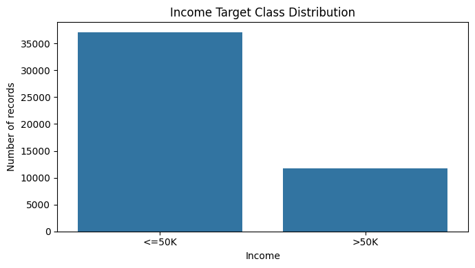
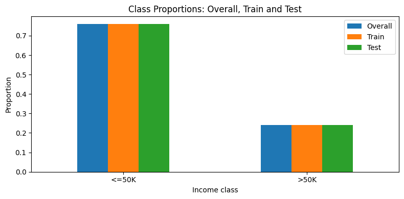
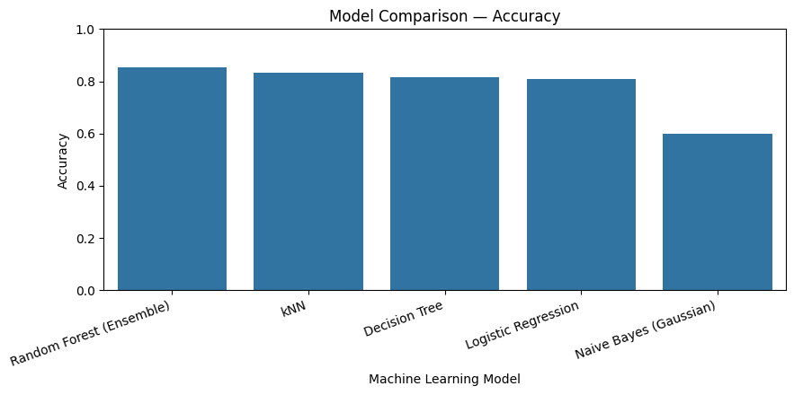
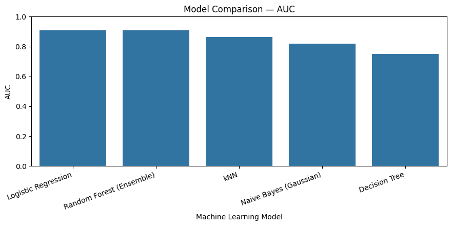
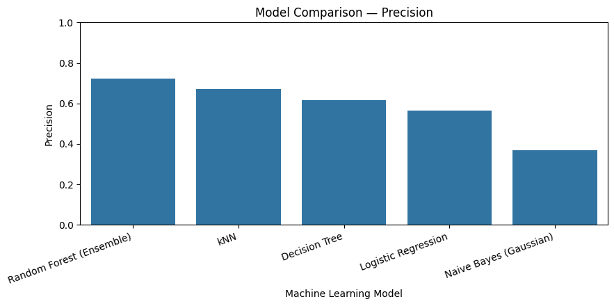
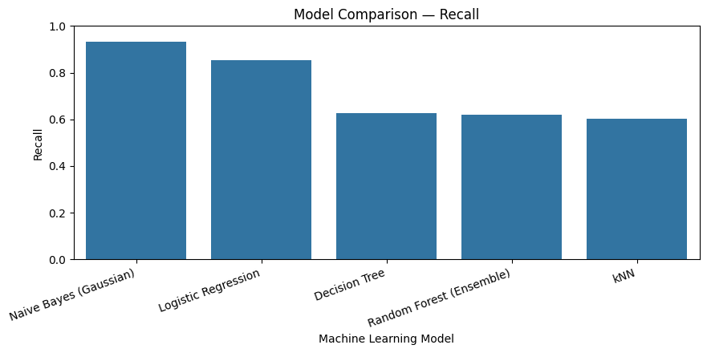
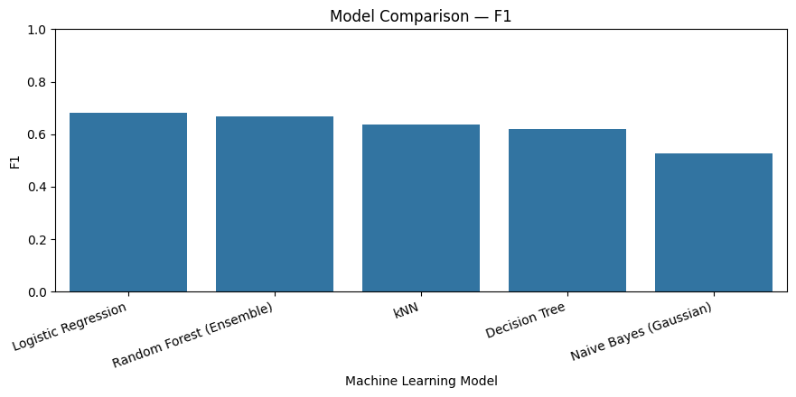
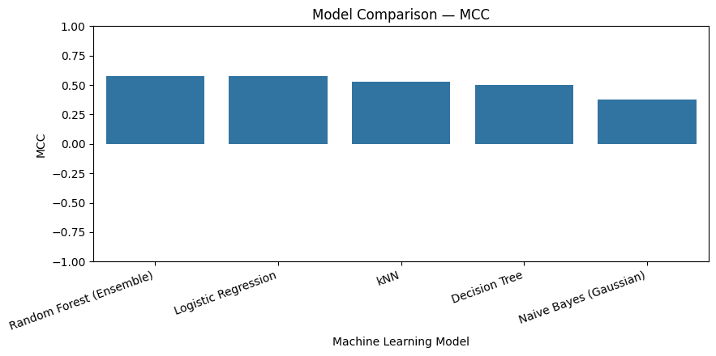
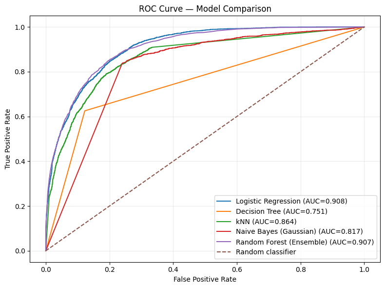
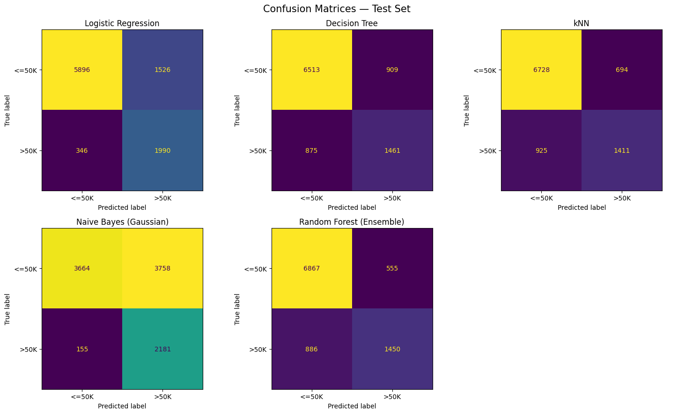

# Machine Learning Assignment 2 — Adult Census Income Classification

## 1. Project Overview

This project implements an end-to-end **binary classification** workflow using the **Adult Census Income** dataset from the UCI Machine Learning Repository. The objective is to predict whether an individual's annual income is `<=50K` or `>50K` using demographic and employment-related attributes.

The notebook covers dataset selection and justification, exploratory analysis, data cleaning, preprocessing, training and comparison of five classification algorithms, evaluation using six metrics, and graphical model analysis.

## 2. Dataset Selection and Justification

- **Dataset:** Adult (Census Income)
- **Repository:** UCI Machine Learning Repository
- **Dataset ID:** `2` (loaded using `fetch_ucirepo(id=2)`)
- **Source:** https://archive.ics.uci.edu/dataset/2/adult
- **Target variable:** `income`
- **Problem type:** Binary classification (`<=50K` and `>50K`)

### Why this dataset was selected

The Adult Census Income dataset is a publicly available, real-world classification dataset that exceeds the assignment minimum of 1,000 instances and 12 input features. It contains both numerical and categorical attributes, making it suitable for demonstrating missing-value treatment, duplicate removal, categorical encoding, feature scaling, and comparison of classification algorithms.

### Dataset dimensions and attributes

The fetched dataset contains **48,842 records** and **14 input features** before duplicate removal. The notebook identifies:

**Numerical features (6):**
- `age`
- `fnlwgt`
- `education-num`
- `capital-gain`
- `capital-loss`
- `hours-per-week`

**Categorical features (8):**
- `workclass`
- `education`
- `marital-status`
- `occupation`
- `relationship`
- `race`
- `sex`
- `native-country`

After duplicate removal, the notebook reports **48,790 records**.

### Target distribution

After duplicate removal, the target distribution is:

| Income class | Records | Percentage |
|---|---:|---:|
| `<=50K` | 37,109 | 76.06% |
| `>50K` | 11,681 | 23.94% |
| **Total** | **48,790** | **100.00%** |

The target is imbalanced, so accuracy is not considered in isolation. Precision, recall, F1-score, AUC, and Matthews Correlation Coefficient (MCC) are also reported.



## 3. Data Preprocessing

The notebook performs the following preprocessing steps:

1. **Missing-value normalization:** Whitespace is stripped and `?` markers are converted to missing values (`NaN`).
2. **Duplicate removal:** Duplicate records are identified using the features and target together; 52 duplicate rows are removed.
3. **Data type handling:** Numerical and categorical columns are identified and their data types are normalized.
4. **Numerical imputation:** Missing numerical values are imputed using the median.
5. **Categorical imputation:** Missing categorical values are imputed using the most frequent value.
6. **Categorical encoding:** One-Hot Encoding is applied to categorical variables. Unseen categories are ignored.
7. **Feature scaling:** `StandardScaler` is applied to numerical features.
8. **Train-test split:** Data is divided into 80% training and 20% testing sets.
9. **Stratification:** The split uses stratification to preserve the target class proportions.
10. **Reproducibility:** `random_state=42` is used.
11. **Leakage prevention:** The preprocessing pipeline is fitted only on training data and then applied to the test data using `transform`.

The preprocessing is implemented using Scikit-learn `Pipeline` and `ColumnTransformer`.

### Train-test split

| Dataset | Records | Percentage |
|---|---:|---:|
| Training set | 39,032 | 80% |
| Test set | 9,758 | 20% |
| **Total after duplicate removal** | **48,790** | **100%** |

The notebook reports that the class proportions are preserved at approximately 76.06% (`<=50K`) and 23.94% (`>50K`) in the overall, training, and test datasets.



The notebook's final preprocessing verification reports zero missing values in both processed training and processed test features.

## 4. Classification Algorithms Implemented

Five classifiers are trained and evaluated using the same preprocessed training and test data:

1. **Logistic Regression** — `max_iter=1000`, balanced class weights, `lbfgs` solver.
2. **Decision Tree** — balanced class weights.
3. **K-Nearest Neighbors (kNN)** — `n_neighbors=5`, distance-based weights.
4. **Gaussian Naive Bayes** — GaussianNB; dense feature arrays are used as required by this implementation.
5. **Random Forest** — 200 estimators and balanced subsample class weights.

All model configurations and training code are included in `ML_Assignment_2.ipynb`.

## 5. Evaluation Metrics

The models are evaluated on the held-out test set using the following six metrics:

- **Accuracy:** Overall proportion of correctly classified records.
- **AUC (ROC-AUC):** Ability to distinguish the two income classes across classification thresholds.
- **Precision:** Proportion of predicted `>50K` cases that are actually `>50K`.
- **Recall:** Proportion of actual `>50K` cases correctly identified.
- **F1-score:** Harmonic mean of precision and recall for the positive (`>50K`) class.
- **MCC:** Matthews Correlation Coefficient, which summarizes the quality of binary classifications while accounting for all four confusion-matrix outcomes.

For the positive-class metrics, `>50K` is treated as the positive class.

## 6. Model Comparison Results

The following values are the recorded results from the executed notebook:

| ML Model | Accuracy | AUC | Precision | Recall | F1-score | MCC |
|---|---:|---:|---:|---:|---:|---:|
| Logistic Regression | 0.8082 | **0.9080** | 0.5660 | **0.8519** | **0.6801** | 0.5744 |
| Decision Tree | 0.8172 | 0.7515 | 0.6165 | 0.6254 | 0.6209 | 0.5005 |
| kNN | 0.8341 | 0.8644 | 0.6703 | 0.6040 | 0.6354 | 0.5296 |
| Gaussian Naive Bayes | 0.5990 | 0.8174 | 0.3672 | **0.9336** | 0.5271 | 0.3736 |
| Random Forest | **0.8523** | 0.9072 | **0.7232** | 0.6207 | 0.6680 | **0.5766** |

### Metric comparison graphs

Each graph compares all five classifiers using one evaluation metric. The values are based on the notebook's recorded test-set results.

#### Accuracy



Random Forest records the highest accuracy (0.8523).

#### AUC



Logistic Regression records the highest AUC (0.9080), closely followed by Random Forest (0.9072).

#### Precision



Random Forest records the highest precision (0.7232).

#### Recall



Gaussian Naive Bayes records the highest recall (0.9336). Logistic Regression follows with 0.8519.

#### F1-score



Logistic Regression records the highest F1-score (0.6801) for the positive `>50K` class.

#### Matthews Correlation Coefficient (MCC)



Random Forest records the highest MCC (0.5766), closely followed by Logistic Regression (0.5744).

## 7. ROC Curve Comparison

The ROC graph compares the true-positive rate against the false-positive rate across thresholds for the five classifiers. The diagonal line represents a random classifier.



The recorded AUC values are:
- Logistic Regression: 0.9080
- Random Forest: 0.9072
- kNN: 0.8644
- Gaussian Naive Bayes: 0.8174
- Decision Tree: 0.7515

## 8. Confusion Matrices

The confusion matrices below show the test-set classification counts for the five models. The class order used in the notebook is `<=50K` followed by `>50K`.



## 9. Overall Model Observation and Conclusion

The notebook selects the overall winner using the highest F1-score for the positive `>50K` class.

**Logistic Regression is the selected model by this criterion**, with:
- F1-score: **0.6801**
- Accuracy: 0.8082
- AUC: 0.9080
- Precision: 0.5660
- Recall: 0.8519
- MCC: 0.5744

Random Forest achieves the highest accuracy (0.8523), precision (0.7232), and MCC (0.5766). Gaussian Naive Bayes achieves the highest recall (0.9336), but its precision and F1-score are lower. Therefore, the preferred model depends on the evaluation objective. Logistic Regression is the notebook's selected model because it achieves the highest positive-class F1-score, while Random Forest provides the highest overall accuracy and precision.

## 10. Repository Structure

```text
ML-Assignment-2/
│
├── README.md
├── requirements.txt
├── test_data.csv
│
├── ML_Assignment_2.ipynb
│
└── graphs/
    ├── income_class_distribution.png
    ├── train_test_class_distribution.png
    ├── accuracy_comparison.png
    ├── auc_comparison.png
    ├── precision_comparison.png
    ├── recall_comparison.png
    ├── f1_comparison.png
    ├── mcc_comparison.png
    ├── roc_curve_comparison.png
    └── confusion_matrices.png
```

> Keep the image paths and folder names unchanged when uploading so that GitHub can render the graphs in this README.

## 11. Requirements and Execution

Install the required Python packages:

```bash
pip install -r requirements.txt
```

Open and execute `ML_Assignment_2.ipynb` using Jupyter Notebook, JupyterLab, or Google Colab. Execute the notebook cells in order, from dataset loading and preprocessing through model training, evaluation, graph generation, and report export.

The notebook uses `ucimlrepo` to fetch the Adult dataset from UCI, so an internet connection is required for the dataset-fetching step.

## 12. Generated Outputs

When the notebook is executed, it generates:

- `test_data.csv` — held-out test features and their true `income` labels.
- `classification_model_results.csv` — model evaluation metrics.
- `classification_model_observations.csv` — model-specific performance observations.
- `classification_graph_observations.csv` — observations for the metric comparison graphs.
- `classification_model_final_report.csv` — combined results and model observations.

The graphs displayed in this README are images extracted from the executed notebook outputs. If the notebook is rerun and the results change, regenerate and replace the corresponding graph images.

---

**Dataset credit:** Adult dataset, UCI Machine Learning Repository — https://archive.ics.uci.edu/dataset/2/adult
